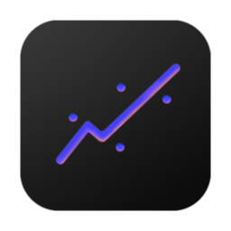
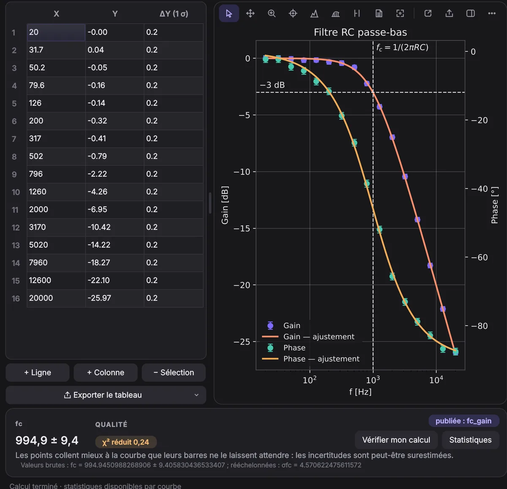

  

<h1 align="center">Regline</h1>

  <strong>Tes mesures de labo, du tableau au rapport.</strong> 
  Logiciel gratuit pour Windows, macOS et Linux.

  <a href="https://regline.ch"><strong>⬇ Télécharger sur regline.ch</strong></a>
  ·
  <a href="https://github.com/Leandro526-c/regline/releases/latest">Dernière version</a>
  ·
  <a href="#english">English</a>

  

---

## Qu'est-ce que Regline ?

Regline aide les étudiantes et étudiants en sciences à traiter leurs données de travaux pratiques : coller un tableau,
obtenir un ajustement avec ses incertitudes, et repartir avec un graphique et des tableaux prêts pour le rapport.

Je m'appelle Leandro, je suis étudiant en bachelor de physique à l'Université de Genève. J'ai développé Regline,
avec l'aide de l'intelligence artificielle, pour faciliter la vie des étudiants pendant leurs TP.

## Ce que Regline sait faire

- **Importer facilement** : coller depuis Excel ou un PDF, ouvrir un CSV, un TXT ou un fichier Excel (.xlsx),
  même un peu désordonné.
- **Des tableaux et des graphiques liés** : un même tableau peut nourrir plusieurs graphiques, et une valeur corrigée
  l'est partout.
- **Ajustements** : régression linéaire (avec ou sans ordonnée forcée), modèles physiques courants et fonctions
  personnalisées, avec incertitudes sur X et/ou Y, χ² et résidus.
- **Propagation des incertitudes** par dérivées partielles, avec la formule affichée en clair.
- **Statistiques** et tests, avec copie en LaTeX ou pour Word en un clic.
- **Vérifier mon calcul** : tape ton propre résultat, Regline te dit s'il est juste et, sinon, quelle erreur classique
  l'explique.
- **Graphiques soignés**, exportables en image, et code matplotlib généré.
- **5 langues** : français, anglais, allemand, italien et espagnol.

Les calculs ont été vérifiés sur les jeux de référence du NIST (StRD) et comparés à Excel.

## Installer

Va sur **[regline.ch](https://regline.ch)** : le site propose automatiquement la bonne version pour ton ordinateur.
Tu peux aussi choisir le fichier dans les [releases](https://github.com/Leandro526-c/regline/releases/latest) :

| Système | Fichier |
|---|---|
| Windows 10 / 11 | **[Microsoft Store](https://apps.microsoft.com/detail/9NDTFSHNBRNZ)** (conseillé, mises à jour automatiques) ou `Regline-…-Windows-Setup.exe` |
| macOS, puce Apple (M1, M2…) | `Regline-…-Darwin-arm64.dmg` |
| macOS, processeur Intel | `Regline-…-Darwin-x86_64.dmg` |
| Linux (x86_64) | `Regline-…-Linux-x86_64.tar.gz` |

Regline est développé par un étudiant, sans certificat d'éditeur payant. Au premier lancement de l'installateur, Windows
(SmartScreen) ou macOS peuvent donc afficher un avertissement (pas avec le Microsoft Store). La page [regline.ch](https://regline.ch) explique comment l'ouvrir
quand même.

Une fois installé, Regline vérifie au plus une fois par jour s'il existe une nouvelle version (désactivable dans
Paramètres).

## Confidentialité

Regline ne demande aucun compte et ne collecte aucune donnée : tes fichiers restent sur ton ordinateur.
Détails : [politique de confidentialité](https://regline.ch/confidentialite.html).

## Un bug, une idée ?

Écris-moi à **[contact@regline.ch](mailto:contact@regline.ch)**, si possible avec une capture d'écran ou ton
fichier `.regline`. Chaque message est lu.

## Soutenir le projet

Regline est et restera gratuit. Si l'app t'aide, tu peux soutenir son développement depuis la section
« Soutenir le projet » de [regline.ch](https://regline.ch/#apropos). Merci ! 💜

## Licence

Regline est gratuit, mais son code source n'est pas public. Ce dépôt contient uniquement le site
[regline.ch](https://regline.ch) et les fichiers d'installation. © 2026 Leandro, tous droits réservés.
Regline utilise des logiciels libres (dont Qt / PySide6 sous LGPL v3), dont les licences sont fournies avec l'app.

Regline est fourni sans garantie : vérifie toujours tes résultats.

---

## English

**Regline** is free software for Windows, macOS and Linux that helps science students handle their lab data:
paste a table, get a fit with uncertainties (on X and/or Y, χ², residuals), propagate uncertainties, run statistics,
check your own result with *Check my calculation*, and export report-ready graphs and LaTeX/Word tables.
Available in English, French, German, Italian and Spanish.

- **Download:** [regline.ch](https://regline.ch) (picks the right file for your computer), the
  [Microsoft Store](https://apps.microsoft.com/detail/9NDTFSHNBRNZ) on Windows, or the
  [latest release](https://github.com/Leandro526-c/regline/releases/latest).
- **Privacy:** no account, no data collected, your files stay on your computer.
  [Privacy policy](https://regline.ch/confidentialite.html#english).
- **Contact:** [contact@regline.ch](mailto:contact@regline.ch)
- **License:** free to use; source code is not public. © 2026 Leandro. Provided without warranty.
